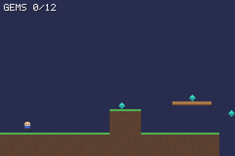
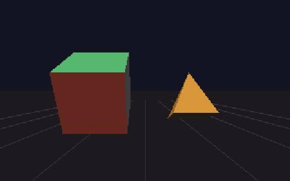
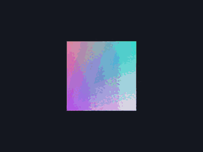
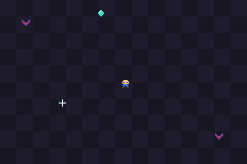
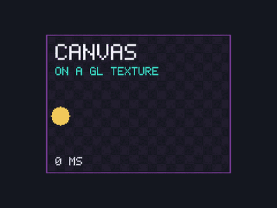

# HolyC Graphics Guide

[](https://github.com/YatoVoid/holyc-graphics-guide/actions/workflows/examples.yml)
[](https://yatovoid.github.io/holyc-graphics-guide/)


[](LICENSE)

Working examples and a docs site for writing graphical programs in HolyC on Linux, macOS and WSL2. They use the [hcc](https://github.com/Jamesbarford/holyc-lang) compiler, SDL2 and OpenGL, with no TempleOS, no VM, and no C or C++ in the examples. It's a reference and a starter kit, not an engine.

**Docs: [yatovoid.github.io/holyc-graphics-guide](https://yatovoid.github.io/holyc-graphics-guide/)** · [Quick start](#quick-start) · [Examples](#featured-examples) · [Compiler quirks](https://yatovoid.github.io/holyc-graphics-guide/compiler-quirks/)

<p align="center">
  
  
  
</p>

## What this repo gives you

- **Thirteen example programs** that compile and run: software drawing, bitmap text, sprites, a scrolling tilemap, sound, gamepads, CPU 3D and OpenGL.
- **Reusable HolyC** in [`examples/common/`](examples/common/): a framebuffer with drawing functions, a bitmap font, a PPM reader and writer, and SDL2, SDL2_image and OpenGL declarations.
- **A docs site** that explains how the pieces fit: the frame loop, binding C libraries, sprites, 3D, sound, memory arenas, profiling and porting from TempleOS.
- **Headless image tests.** Every example that draws has a `--ppm` mode that renders a fixed frame without a window. [`scripts/check.sh`](scripts/check.sh) compares each frame with a recorded SHA-256, and CI runs it on Linux and on Apple Silicon and Intel Macs.
- **One-command setup.** The build scripts for Linux, macOS and WSL2 build the tested hcc commit from source, then every example.
- **A compiler bug reference.** [Compiler quirks](https://yatovoid.github.io/holyc-graphics-guide/compiler-quirks/) lists the hcc bugs found while writing this, each with a reproduction and a workaround, last re-tested in October 2026.

## Quick start

```sh
git clone https://github.com/YatoVoid/holyc-graphics-guide.git
cd holyc-graphics-guide

# Debian/Ubuntu dependencies. Other systems: see docs/installation.md
sudo apt install build-essential cmake git libsdl2-dev libsdl2-image-dev libgl-dev

./scripts/build-linux.sh --install-hcc    # builds hcc into ~/.local, then the examples
export PATH="$HOME/.local/bin:$PATH"
./scripts/check.sh                        # build and check every example

cd examples/sprite-demo && hcc -jit sprite.HC
```

macOS: use `./scripts/build-macos.sh`. Windows: run `.\scripts\build-windows.ps1 -InstallHcc`, which does the same thing inside WSL2. [Installation](https://yatovoid.github.io/holyc-graphics-guide/installation/) covers Fedora, Arch, Homebrew and the details.

## Featured examples

| | |
|---|---|
|  |  |
| **[sprite-demo](examples/sprite-demo/)**: a small game. Sprites stored as ASCII art, fixed-point movement, collision, mouse input, a hit flash. | **[gl-texture](examples/gl-texture/)**: a scene drawn on the CPU every frame, uploaded as an OpenGL texture and shown on a moving quad. |
|  |  |
| **[templeos-bounce](examples/templeos-bounce/)**: TempleOS's `Bounce.HC` ported to hcc, with every change explained in [Porting from TempleOS](https://yatovoid.github.io/holyc-graphics-guide/templeos-porting/). | **[draw-basic](examples/draw-basic/)**: lines, rectangles, circles and triangles in a software framebuffer, saved as an image with no window. |

The animations are frames from each example's own update and drawing code with scripted input, not screen recordings. The still image is the program's output file.

<details>
<summary>All thirteen examples</summary>

| Example | Shows |
|---|---|
| `hello-world` | HolyC syntax: printing, classes, default arguments |
| `draw-basic` | a software framebuffer: lines, rectangles, circles, triangles, saved as an image |
| `font-text` | a 5x7 bitmap font stored as ASCII art, drawn into the canvas at any scale |
| `image-load` | a PPM reader in HolyC and a PNG through SDL2_image, drawn with transparency |
| `sprite-demo` | a small game: window, frame loop, sprites, keyboard and mouse, collision |
| `tilemap` | a scrolling platformer level stored as a string grid: camera, gravity, tile collision |
| `audio` | square-wave beeps queued with `SDL_QueueAudio`, no callbacks |
| `gamepad` | SDL GameController: sticks, triggers and buttons drawn live, hotplug |
| `templeos-bounce` | TempleOS's `Bounce.HC` demo ported to hcc, with every change explained |
| `simple-3d` | 3D on the CPU: projection, back-face culling, lighting, painter's algorithm |
| `sdl-demo` | SDL's 2D renderer driven directly from HolyC |
| `opengl-demo` | OpenGL 3.3 core: shaders, buffers, matrices, depth testing |
| `gl-texture` | a canvas uploaded as a GL texture every frame and drawn on a quad |

[Example programs](https://yatovoid.github.io/holyc-graphics-guide/examples/) has the command to run each one, its controls and its full source.

</details>

## What you can build with it

Each of these starts from code that's already here:

- **A small 2D game.** `tilemap` has the level, camera and collision, `sprite-demo` the sprites and enemies, `audio` the sound effects and `gamepad` the controller input. [Project layout](https://yatovoid.github.io/holyc-graphics-guide/project-structure/) shows how to split a bigger game into files.
- **A program that renders images without a window.** `canvas.HC` draws into memory and writes PPM files, the way `draw-basic` does. That's also how this repo tests its own rendering in CI.
- **An OpenGL program with a CPU-drawn HUD.** `gl-texture` shows how to get anything drawn with `canvas.HC` and `font.HC` onto a GL texture.
- **A port of a TempleOS graphics program.** `templeos-bounce` and its docs page go through replacing `DCAlias`, `GrLine` and the TempleOS window with SDL and the canvas.
- **Bindings to another C library.** [Runtime bindings](https://yatovoid.github.io/holyc-graphics-guide/runtime-bindings/) explains how to declare any C API for hcc, using the SDL and GL declarations here as worked examples.

## How the graphics stack works

hcc compiles HolyC to native x86_64 or AArch64 code and links it with the system `cc`. Programs call C libraries directly:

```holyc
#link <SDL2>
extern "c" I32 SDL_Init(U32 flags);
extern "c" U0 *SDL_CreateWindow(U8 *title, I32 x, I32 y, I32 w, I32 h, U32 flags);
```

So a HolyC game is HolyC for the logic, maths and drawing code, SDL2 for the window and input, OpenGL for GPU rendering, and a few lines of GLSL for shaders. [Runtime bindings](https://yatovoid.github.io/holyc-graphics-guide/runtime-bindings/) covers how to write these declarations for any library.

## Status and testing

Everything here is tested against hcc 0.0.15-beta (commit `06ca611`), the newest upstream version as of October 2026. On every push, CI builds that hcc from source and runs [`scripts/check.sh`](scripts/check.sh):

| Platform | What CI runs |
|---|---|
| Linux x86_64 (Ubuntu 24.04) | all thirteen examples, OpenGL included (on Mesa's software renderer) |
| macOS, Apple Silicon and Intel | all thirteen built, all but the two OpenGL examples run |
| Windows (WSL2) | nothing; the build script runs the Linux build inside WSL2, untested by CI |

What a passing run means: every example that draws has a `--ppm` mode, and its frame must match the SHA-256 sum in [`scripts/checksums.txt`](scripts/checksums.txt) byte for byte, on all three CI platforms (the two OpenGL ones on Linux's llvmpipe only). `beep` must play the recorded samples through SDL's disk driver. The window programs must open and keep running for three seconds. That catches crashes and rendering changes, but not everything a person would notice on screen.

## Limitations

- **hcc is a compiler, not an engine.** It provides the language and a small runtime (strings, memory, files). Windows, input, graphics and audio come from C libraries you bind to.
- **TempleOS graphics aren't available.** `GrLine`, `DCFill`, `Sprite3` and the rest are part of the TempleOS kernel, not HolyC.
- **No native Windows.** hcc targets Linux and macOS. Windows users build and run everything inside WSL2.
- **hcc is beta.** Some code compiles but gives wrong results. [Compiler quirks](https://yatovoid.github.io/holyc-graphics-guide/compiler-quirks/) lists every bug found while writing this guide, with workarounds.
- **Some things aren't checked automatically.** CI doesn't run OpenGL on macOS. The OpenGL frames are only compared on Mesa's llvmpipe, because other drivers round a few pixels differently. Live keyboard, mouse and window handling are only checked for starting without a crash.
- **The renderers are for learning.** The software 3D renderer has no depth buffer or clipping. Image loading takes 8-bit PPM in HolyC, or anything SDL2_image reads.

## What's next

The planned examples, docs and CI coverage are done. Every hcc bug in [Compiler quirks](https://yatovoid.github.io/holyc-graphics-guide/compiler-quirks/) is reported upstream and linked from its entry. The remaining work is re-testing them on each new hcc release and dropping the fixed ones. See the [roadmap](https://yatovoid.github.io/holyc-graphics-guide/roadmap/).

## Contributing

Bug reports, fixes and new examples are welcome. [CONTRIBUTING.md](CONTRIBUTING.md) covers building, running the checks, updating a recorded checksum after an intended change, and reporting hcc bugs.

## **If you liked this project, you can buy me a coffee. It pays for my sanity, [buymeacoffe](https://buymeacoffee.com/walilambere?status=1)**

## Credits

HolyC was created by Terry A. Davis for TempleOS. hcc is by James Barford. The guide and examples are MIT-licensed. See [LICENSE](LICENSE).
