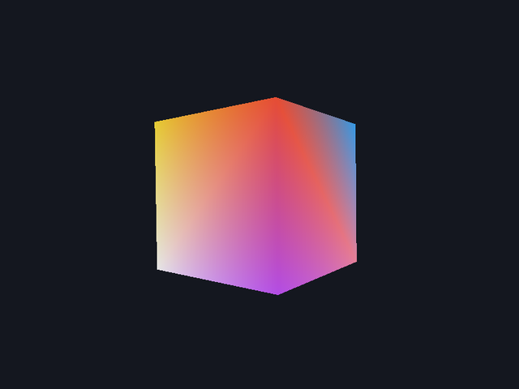
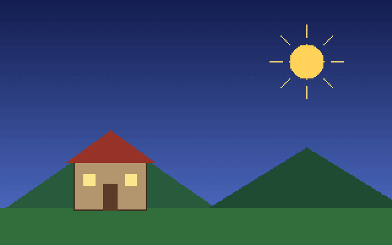
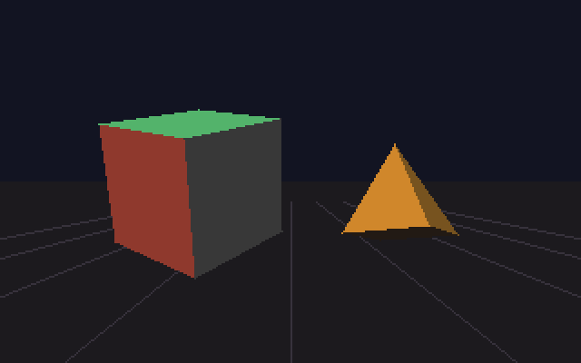

# HolyC Graphics Guide

A guide and starter kit for writing graphical programs in HolyC on Linux, macOS and WSL2. It uses the [hcc](https://github.com/Jamesbarford/holyc-lang) compiler, SDL2 and OpenGL. No TempleOS, no VM, and no C or C++ in the examples.

**Docs: https://yatovoid.github.io/holyc-graphics-guide/**

<p align="center">
  
  
</p>
<p align="center">
  
  
</p>

Every image above is output from the example programs in this repo.

## Quick start

```sh
git clone https://github.com/YatoVoid/holyc-graphics-guide.git
cd holyc-graphics-guide

# Debian/Ubuntu dependencies. Other systems: see docs/installation.md
sudo apt install build-essential cmake git libsdl2-dev libsdl2-image-dev libgl-dev

./scripts/build-linux.sh --install-hcc    # builds hcc into ~/.local, then the examples
export PATH="$HOME/.local/bin:$PATH"
./scripts/check.sh                        # build and run every example

cd examples/sprite-demo && hcc -jit sprite.HC
```

macOS: use `./scripts/build-macos.sh`. Windows: run `.\scripts\build-windows.ps1 -InstallHcc`, which does the same thing inside WSL2.

## What's in here

| Path | Contents |
|---|---|
| [`examples/`](examples/) | thirteen programs, from hello world to an OpenGL cube, plus shared HolyC in `common/` |
| [`docs/`](docs/) | the documentation site (MkDocs Material) |
| [`scripts/`](scripts/) | build scripts for Linux, macOS and WSL2, and `check.sh` |

| Example | Shows |
|---|---|
| `hello-world` | HolyC syntax: printing, classes, default arguments |
| `draw-basic` | a software framebuffer: lines, rectangles, circles, triangles, saved as an image |
| `font-text` | a 5x7 bitmap font stored as ASCII art, drawn into the canvas at any scale |
| `image-load` | a PPM reader in HolyC and a PNG through SDL2_image, drawn with transparency |
| `sprite-demo` | a small game: window, frame loop, sprites, keyboard and mouse, collision |
| `tilemap` | a scrolling platformer level stored as a string grid: camera, gravity, tile collision |
| `audio` | square-wave beeps queued with `SDL_QueueAudio`, no callbacks |
| `gamepad` | SDL GameController: sticks, triggers and buttons drawn live, hotplug |
| `templeos-bounce` | TempleOS's `Bounce.HC` demo ported to hcc, with every change explained |
| `simple-3d` | 3D on the CPU: projection, back-face culling, lighting, painter's algorithm |
| `sdl-demo` | SDL's 2D renderer driven directly from HolyC |
| `opengl-demo` | OpenGL 3.3 core: shaders, buffers, matrices, depth testing |
| `gl-texture` | a canvas uploaded as a GL texture every frame and drawn on a quad |

## How the graphics stack works

hcc compiles HolyC to native x86_64 or AArch64 code and links it with the system `cc`. Programs call C libraries directly:

```holyc
#link <SDL2>
extern "c" I32 SDL_Init(U32 flags);
extern "c" U0 *SDL_CreateWindow(U8 *title, I32 x, I32 y, I32 w, I32 h, U32 flags);
```

So a HolyC game is HolyC for the logic, maths and drawing code, SDL2 for the window and input, OpenGL for GPU rendering, and a few lines of GLSL for shaders. [Runtime bindings](https://yatovoid.github.io/holyc-graphics-guide/runtime-bindings/) covers how to write these declarations for any library.

## Limitations

- **hcc is a compiler, not an engine.** It provides the language and a small runtime (strings, memory, files). Windows, input, graphics and audio come from C libraries you bind to.
- **TempleOS graphics aren't available.** `GrLine`, `DCFill`, `Sprite3` and the rest are part of the TempleOS kernel, not HolyC.
- **No native Windows.** hcc targets Linux and macOS. Windows users build and run everything inside WSL2.
- **hcc is beta.** Some code compiles but gives wrong results. [Compiler quirks](https://yatovoid.github.io/holyc-graphics-guide/compiler-quirks/) lists every bug found while writing this guide, with workarounds.

## Status

A learning resource and starting point, tested against hcc 0.0.15-beta (commit `06ca611`) on Linux x86_64. CI builds hcc and runs every example on Ubuntu, and every example except the two OpenGL ones on macOS on Apple Silicon. Intel Macs aren't tested. See the [roadmap](https://yatovoid.github.io/holyc-graphics-guide/roadmap/) for what's planned.

## Credits

HolyC was created by Terry A. Davis for TempleOS. hcc is by James Barford. The guide and examples are MIT-licensed. See [LICENSE](LICENSE).
