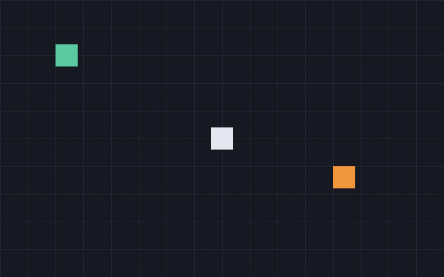

# Example programs

All thirteen build with `./scripts/build-linux.sh` (or `build-macos.sh`) into `build/bin/`, and all are checked by `./scripts/check.sh`. You can also run any of them straight from its folder with `hcc -jit <file>.HC`.

| Example | Needs | Shows |
|---|---|---|
| [hello-world](#hello-world) | nothing | printing, classes, default arguments, loops |
| [draw-basic](#draw-basic) | nothing | software framebuffer, lines, rectangles, circles, triangles, saving an image |
| [font-text](#font-text) | nothing | bitmap font as ASCII art, scaled text, centering, multi-line strings |
| [image-load](#image-load) | SDL2, SDL2_image | reading PPM in HolyC, PNG through SDL2_image, blitting with transparency |
| [sprite-demo](#sprite-demo) | SDL2 | window, frame loop, sprites, animation, keyboard and mouse, collision |
| [tilemap](#tilemap) | SDL2 | level as a string grid, scrolling camera, gravity and jumping, tile collision |
| [audio](#audio) | SDL2 | audio device without callbacks, square waves, queued sound effects |
| [gamepad](#gamepad) | SDL2 | game controller buttons, sticks and triggers, plugging in and out |
| [templeos-bounce](#templeos-bounce) | SDL2 | a TempleOS demo ported: palette, fixed point, range comparisons |
| [simple-3d](#simple-3d) | SDL2 | 3D maths and a software rasterizer: projection, culling, lighting |
| [sdl-demo](#sdl-demo) | SDL2 | SDL's own 2D renderer without the canvas, input, timing |
| [opengl-demo](#opengl-demo) | SDL2, OpenGL 3.3 | GL context, shaders, vertex buffers, matrices, depth testing |
| [gl-texture](#gl-texture) | SDL2, OpenGL 3.3 | canvas uploaded as a texture each frame, textured quad, nearest filtering |

The shared code they include lives in `examples/common/`:

| File | Contents |
|---|---|
| `canvas.HC` | framebuffer and drawing functions, blitting, PPM reader and writer, integer min/max/abs |
| `font.HC` | 5x7 bitmap font: `FontDrawText`, `FontTextWidth` |
| `sdl2.HC` | SDL2 declarations, constants, scancodes, controller buttons and axes, `SdlPumpEvents`, `SdlKeyDown` |
| `audio.HC` | opens an audio device; `AudioBeep` queues a square wave |
| `sdl2_image.HC` | `IMG_Load`; `CanvasLoadImage` reads PNG, JPEG and more into a canvas |
| `screen.HC` | shows a canvas in a scaled window; frame timing; mouse in canvas pixels |
| `gl.HC` | OpenGL 3.3 core declarations |

## hello-world

```sh
cd examples/hello-world && hcc -jit hello.HC
```

```holyc
--8<-- "examples/hello-world/hello.HC"
```

## draw-basic

```sh
cd examples/draw-basic && hcc -jit draw.HC     # writes draw.ppm
```


Draws a sky gradient, hills, a sun and a house into a 320x200 canvas, then saves it as a PPM. Each shape is a single canvas call. It's the best starting point for experimenting, because there's no window to manage.

??? example "draw.HC"
    ```holyc
    --8<-- "examples/draw-basic/draw.HC"
    ```

## font-text

```sh
cd examples/font-text && hcc -jit text.HC     # writes text.ppm
```


Draws a title, the full character set, a score line and a dialogue box into a canvas and saves it. The font lives in `common/font.HC`, so any canvas program can include it for a score or a menu. [Sprites and 2D](sprites.md#bitmap-font-text) explains how the glyphs are stored.

??? example "text.HC"
    ```holyc
    --8<-- "examples/font-text/text.HC"
    ```

## image-load

```sh
cd examples/image-load && hcc -jit load.HC     # writes load.ppm
```


Reads `bricks.ppm` with the PPM reader in `canvas.HC` and `slime.png` with SDL2_image, tiles the bricks, draws the slime over them with its transparent background, and saves the result. No window. [Loading real images](sprites.md#loading-real-images) explains both loaders.

??? example "load.HC"
    ```holyc
    --8<-- "examples/image-load/load.HC"
    ```

## sprite-demo

```sh
cd examples/sprite-demo && hcc -jit sprite.HC
```


| Input | Action |
|---|---|
| ++arrow-keys++ or ++w++ ++a++ ++s++ ++d++ | move |
| left click | release a bat at the cursor |
| ++escape++ | quit |

Collect gems. Every third gem releases another bat, and touching a bat resets your score. The window title shows your score and best. [Sprites and 2D](sprites.md) walks through the code.

## tilemap

```sh
cd examples/tilemap && hcc -jit tilemap.HC
hcc tilemap.HC -o tilemap && ./tilemap --ppm frame.ppm     # no window
```


| Input | Action |
|---|---|
| ++arrow-left++ ++arrow-right++ or ++a++ ++d++ | run |
| ++space++, ++arrow-up++ or ++w++ | jump |
| ++escape++ | quit |

A 100x24 tile level, scrolled by a camera that follows the player. Collect the gems; falling into a pit sends you back to the start. `--ppm` plays two seconds of running and jumping with no window and saves the last frame, which is how `check.sh` tests it. [Sprites and 2D](sprites.md#tilemaps-and-scrolling) explains the level format, collision and camera.

## audio

```sh
cd examples/audio && hcc -jit beep.HC
```

Plays a short tune, a coin pickup and a falling three-note "hurt" sound, then exits. Nothing is drawn. [Sound](audio.md) explains the queue, the square wave and how to use it from a game.

??? example "beep.HC"
    ```holyc
    --8<-- "examples/audio/beep.HC"
    ```

## gamepad

```sh
cd examples/gamepad && hcc -jit pad.HC
```


Draws the first connected controller: bumpers and trigger bars at the top, both sticks, the d-pad, Back/Guide/Start and the face buttons, with raw stick values along the bottom. With no controller it says so, and it picks one up when it's plugged in. ++escape++ quits. [Game controllers](graphics.md#game-controllers) covers the API.

## templeos-bounce

```sh
cd examples/templeos-bounce && hcc -jit bounce.HC
hcc bounce.HC -o bounce && ./bounce --ppm frame.ppm     # no window
```


TempleOS's own `Demo/Graphics/Bounce.HC`, ported: sixteen points in the TempleOS palette bounce around and leave trails. ++escape++ quits. [Porting from TempleOS](templeos-porting.md) shows the original next to the port and explains each change.

## simple-3d

```sh
cd examples/simple-3d && hcc -jit cube.HC
hcc cube.HC -o cube && ./cube --ppm frame.ppm     # one frame, no window
```


A cube and a pyramid rendered on the CPU. ++space++ toggles wireframe. **This is a concept demo for learning the 3D pipeline, not a technique to build a game on.** [3D overview](3d-overview.md) explains each stage and what to use instead.

## sdl-demo

```sh
cd examples/sdl-demo && hcc -jit sdl_example.HC
```



Uses `SDL_RenderFillRect` and `SDL_RenderDrawLine` directly instead of a canvas. ++arrow-keys++ move the white box, holding the left mouse button drags the orange one, and the green one bounces. This is the quickest route to a working 2D game when you don't need per-pixel control.

## opengl-demo

```sh
cd examples/opengl-demo && hcc -jit opengl_example.HC
# macOS, ahead-of-time:
hcc opengl_example.HC -o opengl_example -clibs "-framework OpenGL"
```


A spinning, vertex-coloured cube. It prints the OpenGL version and renderer it got, which is the first thing to check when something doesn't draw.

??? example "opengl_example.HC"
    ```holyc
    --8<-- "examples/opengl-demo/opengl_example.HC"
    ```

## gl-texture

```sh
cd examples/gl-texture && hcc -jit texture.HC
# macOS, ahead-of-time:
hcc texture.HC -o texture -clibs "-framework OpenGL"
```


Draws a scene with the canvas and font every frame, uploads it into an OpenGL texture and shows it on a quad that swings back and forth in 3D. It's the bridge between the software and GPU halves of this guide: anything drawn with `canvas.HC` can end up in a GL scene. [Graphics and rendering](graphics.md#a-canvas-as-an-opengl-texture) covers the byte order, row order and filtering details.

??? example "texture.HC"
    ```holyc
    --8<-- "examples/gl-texture/texture.HC"
    ```
