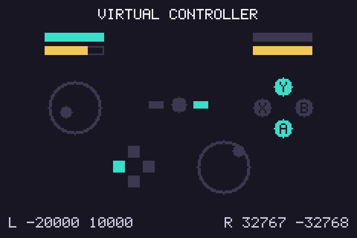
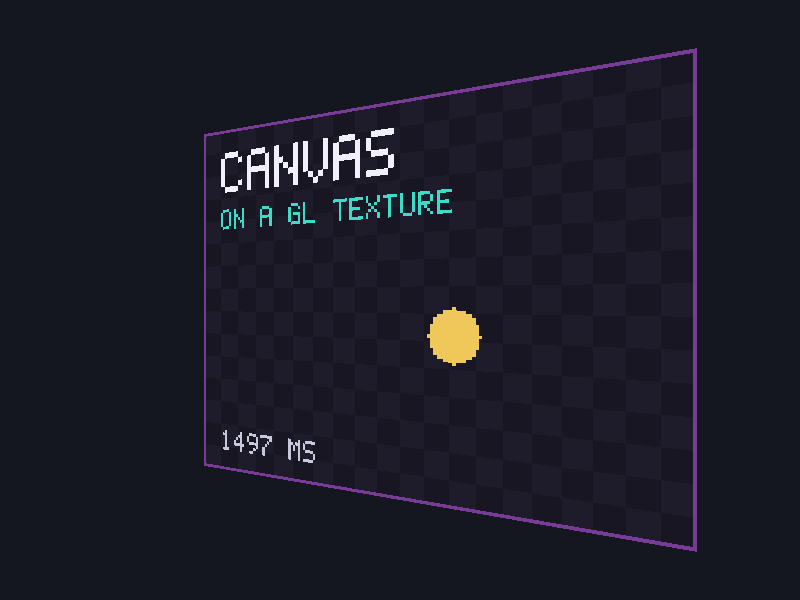

# Graphics and rendering

## Three ways to get pixels on screen

| Approach | Where it runs | What you write | Used by |
|---|---|---|---|
| **TempleOS graphics** | TempleOS only | `GrLine`, `GrRect`, `DCFill`, `Sprite3` … | not usable with hcc |
| **Software rendering** | anywhere | HolyC loops that write colors into an array | `draw-basic`, `font-text`, `sprite-demo`, `tilemap`, `simple-3d` |
| **GPU rendering** | anywhere with OpenGL | HolyC that fills buffers and calls OpenGL, plus small GLSL shaders | `opengl-demo`, `gl-texture` |

**TempleOS graphics** come from the TempleOS kernel: device contexts, a 640x480 16-color screen, sprites stored in documents. None of that is part of the HolyC language, so hcc can't provide it, and there's no compatibility layer. If you're porting TempleOS code, rewrite the drawing on top of the canvas below. It's a small amount of code. [Porting from TempleOS](templeos-porting.md) works through a real TempleOS demo.

**Software rendering** means your program owns a block of memory, one 32-bit color per pixel, and draws into it with ordinary loops. It's the simplest way to learn because nothing is hidden. To show the result, hand the block to SDL once per frame. SDL copies it into a texture and scales it to the window. Small resolutions (320x200, 240x160) are fast even with naive code.

**GPU rendering** is what you want for real 3D or large resolutions. HolyC still runs the program, but triangles are drawn by the graphics card through OpenGL. The GPU needs shader programs written in GLSL, so a GPU-rendered HolyC program always contains a little GLSL.

## The frame loop

Every interactive example has the same shape:

```holyc
while (SdlPumpEvents() && !SdlKeyDown(SC_ESCAPE)) {
  I64 ms = ScreenFrameMs(&screen);   // time since last frame
  Update(&game, ms);                 // move things
  Draw(&game, &screen.canvas);       // draw everything, back to front
  ScreenPresent(&screen);            // show it; waits for vsync
}
```

Some points that matter:

- **Drain events every frame.** `SDL_PollEvent` keeps the OS from deciding your window has hung. `SdlPumpEvents` in `common/sdl2.HC` does this and reports when the window is closed.
- **Scale movement by elapsed time.** Frame rates vary between machines. Multiply speeds by `ms` and things move at the same speed everywhere.
- **Clamp the elapsed time.** After a stall (dragging the window, a breakpoint) the next frame can report hundreds of milliseconds, and objects tunnel through walls. `ScreenFrameMs` caps it at 50 ms.
- **Vsync paces the loop.** With `SDL_RENDERER_PRESENTVSYNC` or `SDL_GL_SetSwapInterval(1)`, presenting waits for the display, so the loop doesn't spin a CPU core at 100%.

## The canvas

`examples/common/canvas.HC` is a framebuffer with drawing functions. It's under 200 lines and has no dependencies.

```holyc
Canvas c;
CanvasInit(&c, 320, 200);
CanvasClear(&c, Rgb(20, 20, 30));
CanvasFillRect(&c, 10, 10, 50, 30, Rgb(200, 80, 60));
CanvasLine(&c, 0, 0, 319, 199, Rgb(255, 255, 255));
CanvasFillCircle(&c, 160, 100, 20, Rgb(250, 210, 90));
CanvasFillTriangle(&c, 10, 190, 60, 120, 110, 190, Rgb(40, 90, 60));
CanvasSavePpm(&c, "out.ppm");
```

Pixels are `U32` values laid out as `0xAARRGGBB`, matching SDL's `SDL_PIXELFORMAT_ARGB8888`, so the array can go to SDL without conversion. Pixel `(x, y)` is at `pixels[y * width + x]`. Every drawing function clips to the canvas, so drawing partly off-screen is safe.

### Lines

`CanvasLine` uses Bresenham's algorithm, which works in integers only:

```holyc
U0 CanvasLine(Canvas *c, I64 x0, I64 y0, I64 x1, I64 y1, U32 color)
{
  I64 dx = AbsI64(x1 - x0), dy = -AbsI64(y1 - y0);
  I64 sx = 1, sy = 1;
  if (x0 > x1)
    sx = -1;
  if (y0 > y1)
    sy = -1;
  I64 err = dx + dy;

  while (TRUE) {
    CanvasPixel(c, x0, y0, color);
    if (x0 == x1 && y0 == y1)
      break;
    I64 e2 = 2 * err;
    if (e2 >= dy) {
      err += dy;
      x0 += sx;
    }
    if (e2 <= dx) {
      err += dx;
      y0 += sy;
    }
  }
}
```

### Triangles

`CanvasFillTriangle` tests every pixel in the triangle's bounding box against its three edges. A pixel is inside when it's on the same side of all three. This is the same idea GPUs use. It isn't the fastest CPU method, but it's short and handles any winding order.

## Showing the canvas in a window

`examples/common/screen.HC` wraps the SDL setup:

```holyc
Screen screen;
if (!ScreenOpen(&screen, "My game", 320, 200, 3))   // 3x scale -> 960x600 window
  return 1;
// ... draw into screen.canvas, then:
ScreenPresent(&screen);
// ... at exit:
ScreenClose(&screen);
```

`ScreenPresent` uploads the canvas with `SDL_UpdateTexture`, then `SDL_RenderCopy` stretches it to the window. Nearest-neighbour scaling is SDL's default, which gives crisp pixel art.

## Input

SDL offers two ways to read input:

- **State:** "is this key down right now?" `SDL_GetKeyboardState` returns an array indexed by scancode. It's best for movement. `SdlKeyDown(SC_LEFT)` wraps it.
- **Events:** "a key was pressed." These come through `SDL_PollEvent`. They're best for one-off actions, but you'd need to decode SDL's 56-byte event union. The examples avoid that and detect presses by comparing the current state against the previous frame:

```holyc
Bool space = SdlKeyDown(SC_SPACE);
if (space && !space_was_down)
  wireframe = !wireframe;
space_was_down = space;
```

The mouse works the same way. `SDL_GetMouseState` returns the button bits and writes the position. `ScreenMouse` divides by the scale so you get canvas coordinates.

Scancodes are physical key positions: `SC_W` is the key where W sits on a US layout, even on AZERTY. That's usually what you want for movement. The values are listed in SDL's `SDL_scancode.h`.

### Game controllers

SDL's GameController API turns any controller it has a mapping for (Xbox, PlayStation, Switch Pro and hundreds of others) into one Xbox-style layout. `PAD_A` is always the bottom face button, whatever is printed on it. The declarations are in `sdl2.HC`, and `examples/gamepad/pad.HC` shows everything a controller reports.



Initialise the subsystem alongside video, then open a controller by joystick index. `PadFind` in the example runs every frame: it keeps the open controller while it's attached and otherwise opens the first one SDL recognises. That handles plugging and unplugging without decoding SDL's device events.

```holyc
SDL_Init(SDL_INIT_GAMECONTROLLER);

U0 *pad = NULL;
// each frame, after SdlPumpEvents():
pad = PadFind(pad);
if (pad && SDL_GameControllerGetButton(pad, PAD_A))
  Jump();
```

Buttons read 1 or 0, and pressed-this-frame detection works the same way as for keys. Axes are `I16`:

| Axis | Range |
|---|---|
| sticks (`PAD_AXIS_LEFTX` …) | -32768 to 32767, with left and up negative |
| triggers (`PAD_AXIS_TRIGGERLEFT`, `…RIGHT`) | 0 to 32767 |

A stick at rest rarely reads exactly 0, so ignore small values before using it for movement. The numbers along the bottom of the example show how much yours drift.

```holyc
I64 x = SDL_GameControllerGetAxis(pad, PAD_AXIS_LEFTX);
if (AbsI64(x) < 8000)
  x = 0;
```

Some things that catch people out:

- **Only the focused window gets input.** Set the environment variable `SDL_JOYSTICK_ALLOW_BACKGROUND_EVENTS=1` to read the controller while another window has focus.
- **Triggers can read 0 until they first move.** Depending on the SDL version and driver, a trigger's position when the controller is opened is ignored, because some drivers report triggers half-pressed at startup.
- **An unknown controller isn't a game controller.** `SDL_IsGameController` returns false for devices with no mapping. Add one with the `SDL_GAMECONTROLLERCONFIG` environment variable, using a line from the community [SDL_GameControllerDB](https://github.com/mdqinc/SDL_GameControllerDB).

## When to move to OpenGL

Stay with the canvas while your game fits in a few hundred thousand pixels per frame and you're drawing flat 2D shapes or sprites. Switch to OpenGL when you want any of these:

- resolutions much above 640x360
- depth-tested 3D with many triangles
- texture filtering, blending or shaders

[3D overview](3d-overview.md) walks through what changes.

## A canvas as an OpenGL texture

Moving to OpenGL doesn't mean throwing the canvas away. A canvas can be a texture: draw a HUD, a minimap or a whole low-resolution game on the CPU, then hand it to the GPU to draw on a quad alongside everything else. `examples/gl-texture/texture.HC` does this every frame, on a quad that turns in 3D.



Create the texture once, at the canvas's size, with no data yet:

```holyc
glTexImage2D(GL_TEXTURE_2D, 0, GL_RGBA8, c->width, c->height, 0,
             GL_BGRA, GL_UNSIGNED_BYTE, NULL);
```

Then after drawing each frame, copy the pixels over it:

```holyc
glTexSubImage2D(GL_TEXTURE_2D, 0, 0, 0, c->width, c->height,
                GL_BGRA, GL_UNSIGNED_BYTE, c->pixels);
```

Three details make this work:

- **Byte order.** A canvas pixel is the `U32` `0xAARRGGBB`. In memory on a little-endian machine its bytes are B, G, R, A, which is what `GL_BGRA` with `GL_UNSIGNED_BYTE` means. No conversion is needed. If red and blue come out swapped, the format says `GL_RGBA` somewhere.
- **Row order.** The canvas stores its top row first, and `glTexSubImage2D` puts the first row it's given at `v = 0`. So the quad's top corners take `v = 0`. Flip that and the image is upside down.
- **Filtering.** Set `GL_TEXTURE_MIN_FILTER` and `GL_TEXTURE_MAG_FILTER` to `GL_NEAREST`, or the GPU blurs a 160x120 canvas into mush when it scales it up.

A 160x120 canvas is 75 KB per frame to upload, which costs nothing. A full 1920x1080 one is about 8 MB, which still works but is where drawing on the GPU starts to pay off.
