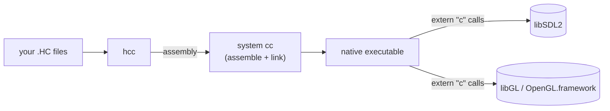

# HolyC Graphics Guide

This guide shows how to write graphical programs in HolyC on a normal desktop OS: draw pixels, open a window, move sprites around, and render 3D. It uses [hcc](https://github.com/Jamesbarford/holyc-lang), a standalone HolyC compiler by James Barford, plus SDL2 and OpenGL. You don't need TempleOS or a VM.

Every image on this site comes from the example programs in [`examples/`](https://github.com/YatoVoid/holyc-graphics-guide/tree/main/examples), built with hcc 0.0.15-beta.

## What this is, and what it isn't

**It is** a guide and a starter kit: thirteen small programs that compile, a few hundred lines of reusable HolyC (a software framebuffer, SDL2 and OpenGL declarations), and docs explaining how they fit together.

**It isn't** an engine. hcc is a compiler. It gives you the HolyC language and a small runtime library (strings, memory, files, hash tables), but no windowing, input, audio or graphics. For those you call native C libraries from HolyC, which is most of what this guide teaches.

!!! note "TempleOS graphics don't come with you"
    TempleOS has its own graphics API (`GrPlot`, `GrLine`, `DCFill`, sprites in `$SP$` doc entries, and so on). That API is part of the TempleOS kernel, not the language, and hcc doesn't provide it. Code written against it won't compile here. [Graphics and rendering](graphics.md#three-ways-to-get-pixels-on-screen) explains what replaces it.

## How the pieces fit

hcc turns HolyC into x86_64 or AArch64 assembly, then calls the system C compiler to assemble and link it. Because the result is an ordinary native binary, it can call any C library: you declare the functions with `extern "c"` and name the library with `#link`. hcc can also JIT-compile and run a file in-process with `hcc -jit`, which is handy while iterating.

## Platform support

| Platform | Status |
|---|---|
| Linux x86_64 | Works. All examples tested here. |
| macOS on Apple Silicon | Works. CI builds every example and runs all but the two OpenGL ones. |
| macOS on Intel | Supported by hcc upstream, but not tested here. |
| Windows | Only through WSL2. hcc has no Windows backend, so it can't produce `.exe` files. Windows 11 shows WSL2 windows through WSLg. |

## Where to start

1. [Installation](installation.md): install the dependencies and hcc.
2. [Quick start](quickstart.md): compile and run your first program, then open a window.
3. [Graphics and rendering](graphics.md): the frame loop, the software canvas, and when to switch to OpenGL.
4. [Compiler quirks](compiler-quirks.md): read this before writing much code. hcc is beta software, and a few bugs will bite you.
