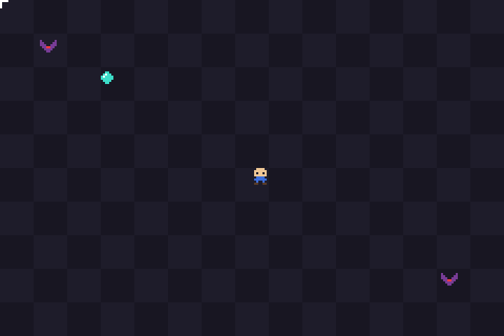
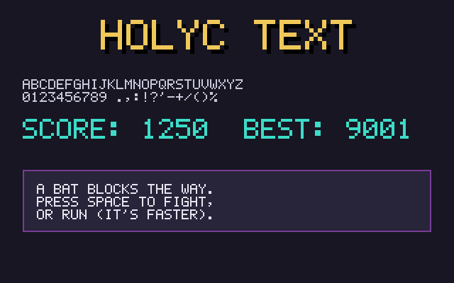
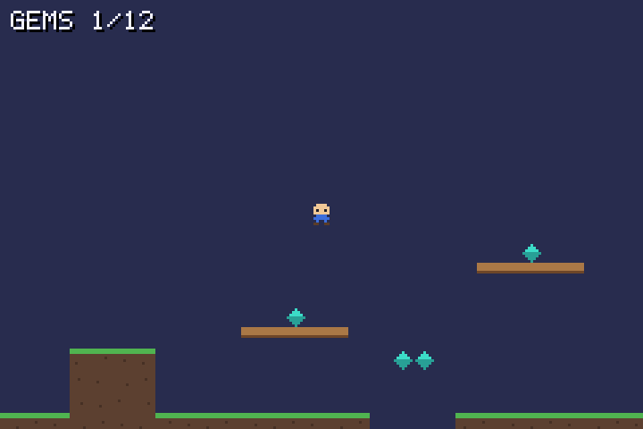
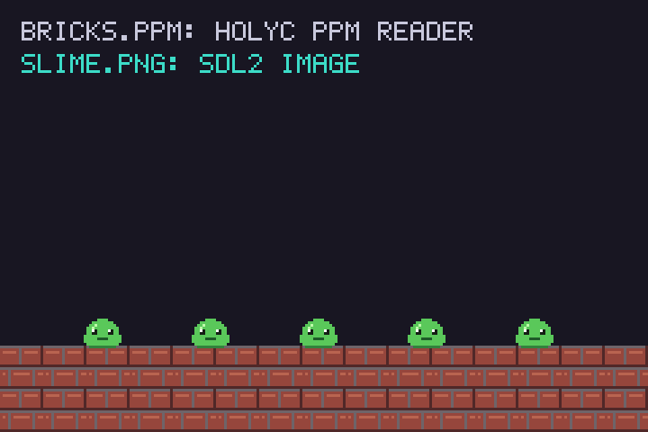

# Sprites and 2D



`examples/sprite-demo/sprite.HC` is a complete small game: a player, collectibles, enemies, collision, a hit flash, a score, and mouse input. It's about 300 lines. This page walks through the techniques it uses.

## Sprites as text

Instead of loading image files, the sprites are written directly in the source as character grids:

```holyc
U8 *g_gem_rows[SPRITE_SIZE] = {
  "........",
  "...cc...",
  "..cwcc..",
  ".cwcccc.",
  ".cccccc.",
  "..cccc..",
  "...cc...",
  "........",
};
```

Each character maps to a color, and `.` is transparent:

```holyc
U32 PaletteColor(U8 ch)
{
  switch (ch) {
    case 'c': return Rgb(60, 220, 200);
    case 'w': return Rgb(230, 255, 255);
    // ...
  }
  return Rgb(255, 0, 255);   // magenta: a character with no color assigned
}
```

Drawing a sprite loops over the grid and skips the dots. That's all a sprite blitter is:

```holyc
for (I64 row = 0; row < SPRITE_SIZE; row++) {
  U8 *line = s->rows[row];
  for (I64 col = 0; col < SPRITE_SIZE; col++) {
    U8 ch = line[col];
    if (ch == '.')
      continue;
    CanvasPixel(c, x + col, y + row, PaletteColor(ch));
  }
}
```

The approach keeps the program to a single file, makes the art easy to diff in git, and means there's no image loader to write. For larger art, see [Loading real images](#loading-real-images).

### Animation

The bat has two frames, wings up and wings down, and switches every 120 ms:

```holyc
Sprite *bat = &g_bat_up;
if ((g->clock_ms / 120) % 2)
  bat = &g_bat_down;
```

More frames work the same way: an array of sprites indexed by `(clock / frame_ms) % frame_count`.

### Flashing

After a hit, the player flashes white for a second. `DrawSprite` takes an optional tint that replaces every opaque pixel's color:

```holyc
U32 tint = 0;
if (g->hurt_ms > 0 && (g->hurt_ms / 80) % 2)
  tint = Rgb(255, 255, 255);
DrawSprite(c, &g_hero, x, y, tint);
```

## Movement with fixed-point numbers

Positions are stored as integers scaled by 256, so `x = 2560` means pixel 10. To draw, divide by 256.

```holyc
#define FP 256
h->x += dx * PLAYER_SPEED * ms;   // PLAYER_SPEED is in 1/256 px per ms
DrawSprite(c, &g_hero, h->x / FP, h->y / FP);
```

This gives smooth sub-pixel movement without floating point. It's a classic technique for 2D games, and with hcc there's a second reason to use it: integer comparisons don't run into the [float comparison bugs](compiler-quirks.md#float-comparisons).

## Collision

Each actor is treated as an 8x8 box, shrunk slightly so near-misses don't count. Two boxes overlap unless one is completely to the left, right, top or bottom of the other:

```holyc
Bool Overlaps(Actor *a, Actor *b)
{
  I64 ax = a->x / FP, ay = a->y / FP;
  I64 bx = b->x / FP, by = b->y / FP;
  if (ax + SPRITE_SIZE - 2 <= bx + 1 || bx + SPRITE_SIZE - 2 <= ax + 1)
    return FALSE;
  if (ay + SPRITE_SIZE - 2 <= by + 1 || by + SPRITE_SIZE - 2 <= ay + 1)
    return FALSE;
  return TRUE;
}
```

## Fixed pools instead of allocation

Bats live in a fixed array with an `alive` flag:

```holyc
Actor bats[MAX_BATS];
```

Spawning finds the first dead slot, and nothing is ever freed. For games with a known upper bound on objects, this avoids per-frame `MAlloc`/`Free` and the leaks and crashes that come with them.

## Random numbers

hcc's runtime library has no random-number functions, so the demo uses a three-line linear congruential generator seeded from `SDL_GetTicks()`. (You could declare libc's `rand` with `extern "c"` instead.) Owning the generator also makes runs reproducible: seed it with a constant and the same bats appear in the same places, which helps when debugging.

## Bitmap font text



The window title works for a score, but anything inside the game needs text drawn into the canvas. `examples/common/font.HC` is a 5x7 font stored the same way as the sprites. Fitting 48 glyphs one per array would take 48 arrays, so they're packed eight to a band, with a blank column between each:

```holyc
U8 *g_font_chars = "ABCDEFGHIJKLMNOPQRSTUVWXYZ0123456789.,:!?'-+/()%";

U8 *g_font_rows[] = {
  // A     B     C     D     E     F     G     H
  ".###. ####. .###. ####. ##### ##### .###. #...#",
  "#...# #...# #...# #...# #.... #.... #...# #...#",
  // ...five more rows, then the next band
};
```

A character's position in `g_font_chars` says where its art is: band `i / 8`, starting column `(i % 8) * 6`. Drawing a glyph is the sprite loop with one color, and each lit cell is a `scale` x `scale` square, so the same font works for small labels and big titles:

```holyc
for (I64 row = 0; row < FONT_H; row++) {
  U8 *line = g_font_rows[first_row + row];
  for (I64 col = 0; col < FONT_W; col++)
    if (line[first_col + col] == '#')
      CanvasFillRect(c, x + col * scale, y + row * scale, scale, scale, color);
}
```

`FontDrawText` walks the string, moving the pen 6 pixels per character and down 9 on `'\n'`. Lowercase is drawn as uppercase, and characters missing from the font leave a gap. To add one, append it to `g_font_chars` and its art to `g_font_rows`. The last band is full, so a new glyph starts a new band of seven rows.

Numbers go through `StrPrint` first:

```holyc
U8 score[64];
StrPrint(score, "Score: %d", g->score);
FontDrawText(c, 4, 4, score, Rgb(60, 220, 200));
```

`FontTextWidth` returns the pixel width of the longest line, which is what centering needs. A drop shadow is the same text drawn one step down and right in black, before the real color:

```holyc
I64 x = (c->width - FontTextWidth(text, scale)) / 2;
FontDrawText(c, x + scale, y + scale, text, Rgb(0, 0, 0), scale);
FontDrawText(c, x, y, text, color, scale);
```

## Tilemaps and scrolling



`examples/tilemap/tilemap.HC` is a platformer level 100 tiles wide, with a camera that follows the player. The level is another string grid, one character per 8x8 tile:

```holyc
// '#' ground, '=' platform, '*' gem, '@' where the player starts.
U8 *g_level_rows[MAP_H] = {
  // ...
  "..............####...........**..................................####...",
  "...@..........####...............................................####...",
  "############################....#######################.....############",
};
```

String literals are read-only, so `LoadLevel` copies the grid into a `U8 map[MAP_W * MAP_H]` inside the game. That copy is what the game reads and changes: collecting a gem overwrites its `'*'` with `'.'`.

### Collision against tiles

The player is a 6x8 box. Since it's no bigger than a tile, checking its four corners against the map is enough to tell whether it overlaps anything solid.

Movement happens one axis at a time. Move along x, and if the box now overlaps a solid tile, push it back to that tile's edge and stop horizontal movement. Then do the same along y:

```holyc
p->y += p->vy * ms / 1000;
I64 px = p->x / FP, py = p->y / FP;
if (!BoxSolid(g, px, py, PLAYER_W, PLAYER_H))
  return;
if (p->vy > 0)
  py = (py + PLAYER_H - 1) / TILE * TILE - PLAYER_H;   // landed on a floor
else
  py = (py / TILE + 1) * TILE;                         // hit a ceiling
p->y = py * FP;
p->vy = 0;
```

Resolving each axis separately is what lets the player slide along a wall while falling, instead of sticking to it. Whether the player is standing is a separate question: after moving, check the box one pixel lower. If that's solid, a jump is allowed.

Two details keep this correct:

- **Small steps.** A slow frame could move the player more than a tile at once and carry them through a floor. `Update` splits each frame into steps of at most 10 ms. At top falling speed that's 3 pixels per step.
- **Negative coordinates.** Integer division rounds toward zero, so pixel `-3` divided by 8 is tile 0, not tile -1. The player's x is clamped at 0 instead of relying on a tile column left of the map.

### The camera

The camera is the level-space position of the screen's top-left corner. It centres on the player, then clamps so it never shows past the level's edges:

```holyc
I64 x = p->x / FP + PLAYER_W / 2 - WIDTH / 2;
x = MaxI64(0, MinI64(x, MAP_W * TILE - WIDTH));
```

Everything is drawn at its level position minus the camera. Only the tiles the screen can show are drawn: from `cam_x / TILE` across `WIDTH / TILE + 1` tiles, where the extra one covers a tile cut off at the edge.

### Input as data

`Update` takes an `Input` (a direction and a jump flag) instead of reading the keyboard itself. The window loop fills it from SDL. `--ppm` mode fills it with "hold right and jump" for two seconds, then saves the frame. That's a full game update tested without a window, the approach [Project layout](project-structure.md#structuring-your-own-game) recommends.

## Loading real images



hcc has no image decoder, but there are two short routes into a canvas. `examples/image-load/load.HC` uses both: the bricks are a PPM read by HolyC, and the slime is a PNG read by SDL2_image.

### PPM, in HolyC

A binary PPM is a short text header, `P6`, then width, height and the maximum channel value, followed by raw RGB bytes. `CanvasLoadPpm` in `canvas.HC` reads the header with `FileRead` and a small number parser that skips `#` comments, then converts each RGB triple with `Rgb`:

```holyc
Canvas bricks;
if (!CanvasLoadPpm(&bricks, "bricks.ppm"))
  return 1;
```

It only accepts 8-bit binary PPMs (`P6` with a maximum of 255). That's what `CanvasSavePpm` writes and what ImageMagick produces by default, so any image can be converted ahead of time:

```sh
magick tiles.png tiles.ppm
```

PPM has no alpha channel, so every pixel comes in opaque. It needs no library at all.

### PNG and JPEG, through SDL2_image

`examples/common/sdl2_image.HC` binds `IMG_Load`, which returns an `SDL_Surface`. A surface can come back in any pixel format, so `CanvasLoadImage` asks SDL to convert it to `SDL_PIXELFORMAT_ARGB8888` first. That's the canvas's own layout, alpha included. Then it copies the pixels row by row, since a surface's rows can be padded beyond `w * 4` bytes and `pitch` says by how much:

```holyc
U8 *row = argb->pixels;
for (I64 y = 0; y < argb->h; y++) {
  MemCpy(c->pixels + y * c->width, row, argb->w * sizeof(U32));
  row += argb->pitch;
}
```

`SdlSurface` in `sdl2.HC` declares only the first fields of C's `SDL_Surface`, the ones a program reads. That's safe because HolyC never allocates one; it only reads through pointers SDL returns.

The binding lives in its own file with its own `#link <SDL2_image>`, so programs that don't include it don't link the library.

### Drawing with transparency

`CanvasBlit` copies one canvas onto another and skips pixels whose alpha is below half. A PNG with a transparent background draws as a sprite; a PPM, being fully opaque, draws as a solid rectangle. Canvas drawing functions always write full alpha, so a canvas you've drawn on blits the same way.

Asset paths like `"bricks.ppm"` resolve against the working directory, which is why the example is run from its folder. For a real game, see [Assets](project-structure.md#assets).

The other option is to skip files and generate the art in code. Ossuary, a HolyC game this guide grew out of, generates all its textures procedurally.
