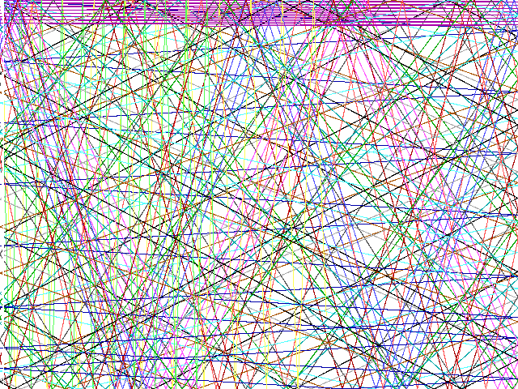

# Porting a TempleOS program

This page ports a real TempleOS program to hcc and SDL2: [`Demo/Graphics/Bounce.HC`](https://github.com/cia-foundation/TempleOS/blob/archive/Demo/Graphics/Bounce.HC) from the TempleOS source. It's 47 lines: sixteen points, one per palette color, bounce around a window and leave trails. TempleOS is public domain, so the original is reproduced in full.

The port is `examples/templeos-bounce/bounce.HC`. It builds with the other examples and is checked by `check.sh`.

```sh
cd examples/templeos-bounce && hcc -jit bounce.HC
```



## The original

TempleOS stores source in code page 437, not UTF-8. It's converted here so `Θ` and `π` display, but the bytes on disk are `0xE9` and `0xE3`. The first line is a DolDoc hyperlink, which TempleOS's editor shows as a link to its fixed-point lecture.

```holyc
//Uses $LK,"fixed-point-arithmetic",A="FI:::/Demo/Lectures/FixedPoint.HC"$.

I64 x[16],y[16],dx[16],dy[16];

U0 Init()
{
  I64 i;
  F64 Θ;
  MemSet(x,0,sizeof(x));
  MemSet(y,0,sizeof(y));
  for (i=0;i<16;i++) {
    Θ=Rand*2*π;
    dx[i]=I32_MAX*Cos(Θ);
    dy[i]=I32_MAX*Sin(Θ);
  }
}
 
U0 Bounce()
{
  CDC *dc=DCAlias;
  I64 i,ch;
  Init;
  try {//Catch <CTRL-ALT-c>
    do {
      for (i=0;i<16;i++) {
        dc->color=i;
        GrPlot(dc,x[i].i32[1],y[i].i32[1]);
        x[i]+=dx[i];
        y[i]+=dy[i];
        if (!(0<=x[i]<Fs->pix_width<<32)) {
          x[i]-=dx[i];
          dx[i]=-dx[i];
        }
        if (!(0<=y[i]<Fs->pix_height<<32)) {
          y[i]-=dy[i];
          dy[i]=-dy[i];
        }
      }
      Yield;
    } while (!(ch=ScanChar) || (ch!=CH_SHIFT_ESC && ch!=CH_ESC));
  } catch
    PutExcept;
  DCFill(dc);
  DCDel(dc);
}
 
Bounce;
```

## The port

??? example "bounce.HC"
    ```holyc
    --8<-- "examples/templeos-bounce/bounce.HC"
    ```

## What changed

### Where the pixels go

`DCAlias` returns a device context that draws straight onto the current window, on top of its document. Nothing clears it, so every `GrPlot` stays on screen, and that's what draws the trails. When the loop ends, `DCFill(dc)` with no colour fills it with `TRANSPARENT`, and the trails disappear.

The port draws into the canvas that `screen.HC` shows. The canvas is cleared to white once, the colour of a TempleOS window's document, and never again, so the trails survive. `ScreenClose` replaces `DCFill` and `DCDel`. `Fs->pix_width` and `Fs->pix_height`, the window's size, become `c->width` and `c->height`.

### Colours

`dc->color=i` picks one of TempleOS's 16 palette colours by index. The canvas takes 32-bit colours, so the port copies TempleOS's standard palette (`gr_palette_std` in `Adam/Gr/GrPalette.HC`) into a table and indexes that:

```holyc
CanvasPixel(c, x[i] >> 32, y[i] >> 32, g_palette[i]);
```

The table is in the order of TempleOS's colour constants, so `g_palette[RED]` works if you also copy their values (`BLACK` is 0, through `WHITE`, 15).

### Fixed point

Positions are 32.32 fixed point, and the original reads the whole-pixel part with `x[i].i32[1]`: the upper half of the `I64`, viewed as an `I32`. That sub-integer access is a TempleOS feature. hcc reports `Expected as class however got integer type`. A shift does the same thing:

```holyc
x[i].i32[1]   // TempleOS
x[i] >> 32    // hcc
```

### Missing names

hcc's runtime is much smaller than TempleOS's, and its lexer only accepts ASCII names:

| Original | Port |
|---|---|
| `F64 Θ` | `F64 angle` |
| `π` | `#define PI 3.14159265358979` |
| `I32_MAX` | `#define I32_MAX 0x7FFFFFFF` |
| `Cos`, `Sin` | `cos`, `sin` |
| `Rand` | a 64-bit LCG returning an `F64` in [0, 1), with a fixed seed |

The `Rand` replacement masks its shifted state before converting it, because of an hcc bug: [`>>` on a `U64` copies the sign bit](compiler-quirks.md#unsigned-64-bit-shifts-and-conversions). Without the mask, half the values come out negative.

### Calls without parentheses

HolyC lets you call a function with no arguments without the parentheses, and hcc supports it: `Init;` is unchanged in the port. Inside a float expression it isn't supported. `Θ=Rand*2*π;` fails the build with `Binop has returned null type`, so the port writes `Rand()`.

### One global per line

`I64 x[16],y[16],dx[16],dy[16];` is four globals in one declaration, which [hcc can't parse](compiler-quirks.md#one-global-per-declaration). The port declares them on four lines.

### The loop

The original runs as fast as the scheduler lets it. Each pass through the loop moves every point once and then calls `Yield`, which gives other tasks a turn. `ScanChar` returns a character if one was typed, and the loop stops on Esc or Shift-Esc. `try`/`catch` exists so ++ctrl+alt+c++, TempleOS's break key, still runs the cleanup after it.

The port uses the frame loop every example here uses. It pumps SDL's events, checks Esc with `SdlKeyDown`, runs `STEPS_PER_FRAME` steps, then presents one frame. hcc accepts `try`/`catch`, but there's no break key to catch, so it's gone. The original's speed depends on the machine; the port's is fixed by the frame rate and `STEPS_PER_FRAME`.

### The entry point

A TempleOS file runs top to bottom when it's included, and `Bounce;` on the last line starts it. hcc runs top-level statements too, but every example here uses `I32 Main()` so it can take arguments: `--ppm` runs 20,000 steps with no window and saves the image, which is how `check.sh` tests the port and how the screenshot above was made.

## What carried over

More than you might expect:

- **Range comparisons.** `if (!(0<=x[i]<Fs->pix_width<<32))` means "outside [0, width)" in TempleOS, and means the same in hcc. In C it would compare a 0-or-1 result against the width and always be true.
- **Calls without parentheses** outside expressions, like `Init;`.
- **`MemSet(x,0,sizeof(x))`** on a global array.
- **`dx[i]=-dx[i]`**. hcc has a bug [negating an indexed value](compiler-quirks.md#negating-an-indexed-value), but it only affects expressions with more after the negated term.
- **The `"..."` print statement**, default arguments, and the HolyC types.

## Porting other programs

The TempleOS graphics calls that have a direct equivalent here. Signatures are from TempleOS's `Adam/Gr` sources.

| TempleOS | This guide |
|---|---|
| `Fs->draw_it=&DrawIt;` | call `DrawIt(&screen.canvas)` each frame, before `ScreenPresent` |
| `dc->color=RED;` | pass a colour to each call; `Rgb(170, 0, 0)` is TempleOS's red |
| `GrPlot(dc,x,y)` | `CanvasPixel(c, x, y, color)` |
| `GrLine(dc,x1,y1,x2,y2)` | `CanvasLine(c, x1, y1, x2, y2, color)` |
| `GrRect(dc,x,y,w,h)` (filled) | `CanvasFillRect(c, x, y, w, h, color)` |
| `GrBorder(dc,x1,y1,x2,y2)` (outline, corners) | `CanvasRect(c, x1, y1, x2 - x1 + 1, y2 - y1 + 1, color)` |
| `GrFillCircle(dc,cx,cy,0,diameter)` | `CanvasFillCircle(c, cx, cy, diameter / 2, color)` |
| `GrCircle(dc,cx,cy,radius)` (outline) | no equivalent yet; write a midpoint circle |
| `GrPrint(dc,x,y,fmt,...)` | `StrPrint` into a buffer, then `FontDrawText` |
| `DCFill(dc)`, `DCClear(dc)` | `CanvasClear(c, color)` |
| sprites in `$SP$` entries, `Sprite3` | [ASCII-art sprites](sprites.md#sprites-as-text), or export to PNG and [load it](sprites.md#loading-real-images) |
| `ScanChar`, `GetKey` | `SdlKeyDown` with the previous frame's state, as in [Input](graphics.md#input) |
| `Bt(kbd.down_bitmap,sc)` | `SdlKeyDown(scancode)` |
| `Sleep(ms)` | `SDL_Delay(ms)`, or let the frame loop's vsync set the pace |

Two differences cut across all of these. TempleOS's font is 8x8 and has lowercase; [`font.HC`](sprites.md#bitmap-font-text) is 5x7 uppercase. TempleOS scan codes are PC keyboard codes, while SDL's are USB codes, so translate keys by name (`SC_CURSOR_LEFT` becomes `SC_LEFT`), not by number.
